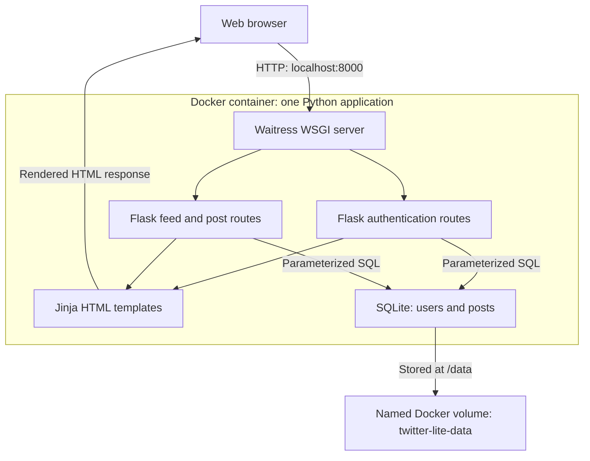
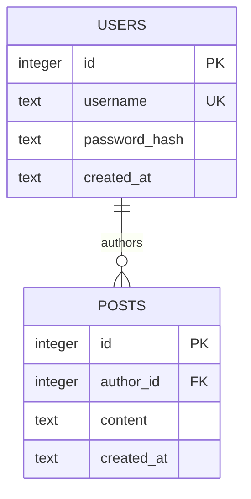

# Part D - Architecture and technology

**Draft for student review.** The reference design is a small monolithic,
server-rendered web application. The diagrams below use Mermaid, which GitHub
renders in Markdown files.

## Runtime architecture

CSS is served from `app/static/`. Browser form requests are protected with
Flask-WTF CSRF tokens. Flask signs the session cookie using a random key stored
with the database; user IDs come from the validated session. The volume also
stores that key, so ordinary container recreation does not change it.

The application has separate Python modules but one deployable process. Modules
are not microservices. SQLite is a file-backed database accessed by the same
process, not a second container or independent API service.

## Database relationship

One user can author zero or more posts; each post belongs to exactly one user.
Users and posts have integer primary keys. `username` is unique after application
normalization. `posts.author_id` has an enforced foreign key to `users.id`.
Creation times are ISO 8601 UTC strings with a consistent format. The index on
`posts(created_at DESC, id DESC)` supports feed ordering.

Users are stored separately from posts so their username/password information
is not repeated in every post. Each table describes one entity; the join brings
the username into the feed. This avoids update anomalies from duplicated user
details. Two entity tables meet this brief; it does not require six tables.

## Technology choices

| Layer | Choice | Reason and trade-off |
|---|---|---|
| Frontend | HTML/CSS and Jinja | No separate JavaScript build or API client; sufficient for forms/feed. Rich live interactions would need more client work. |
| Backend | Python 3.12 and Flask | Small routing/application-factory structure that is easy to inspect and test. Libraries supply security primitives; the app still needs correct configuration. |
| Server | Waitress | WSGI server that runs on Windows and Linux; supports the same local command on either. One process is sufficient for this MVP. |
| Database | SQLite | Built into Python; file persistence avoids a separate database service. Serialized writes limit scale; future production could use PostgreSQL. |
| Passwords | Argon2id via argon2-cffi | Salted adaptive hashing using an established library and OWASP minimum settings. Adds a dependency and CPU/memory work during authentication. |
| Authentication | Signed Flask session cookie | Simple built-in authentication state; no separate token API is needed. Session content is signed, not encrypted, and logout is not central revocation. |
| CSRF | Flask-WTF CSRFProtect | Standard token validation on state-changing forms; avoids implementing token cryptography ourselves. |
| Tests | pytest + Flask test client | Fast isolated checks with temporary databases; complemented by real HTTP/Docker and manual browser checks. |
| Local runtime | Docker Compose + named volume | Documented single-command build/run and data outside container lifecycle. Docker availability still has to be verified on the demo machine. |
| Automation | GitHub Actions | Installs packages, executes tests and builds/checks Docker on push. Requires an actual repository/run to provide assessment evidence. |

## Key request flows

Registration validates username/password, hashes with Argon2id and inserts an
account. Login fetches the account with parameterized SQL, verifies the hash,
clears previous session state and sets the user ID. Every later request resolves
that ID to an existing user. A protected publish request gets its author from
that authenticated user, inserts the text/time and redirects to the feed.

The feed joins posts to users, sorts by time and ID descending, and renders at
most 20 posts. Jinja escapes untrusted text; content is not treated as HTML.
Logout uses a CSRF-protected POST and clears the browser's authentication state.

## Decisions and constraints

See [ADR-001](adr/001-monolith-and-sqlite.md) and
[ADR-002](adr/002-authentication-and-passwords.md). There is no production
deployment requirement. Public hosting would require additional security and
scaling decisions, rather than just exposing this container to the Internet.
